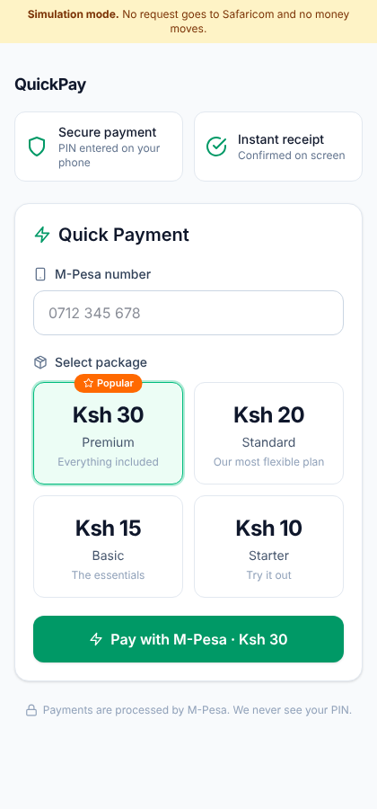
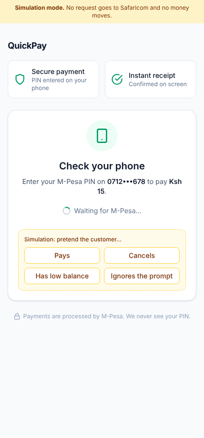
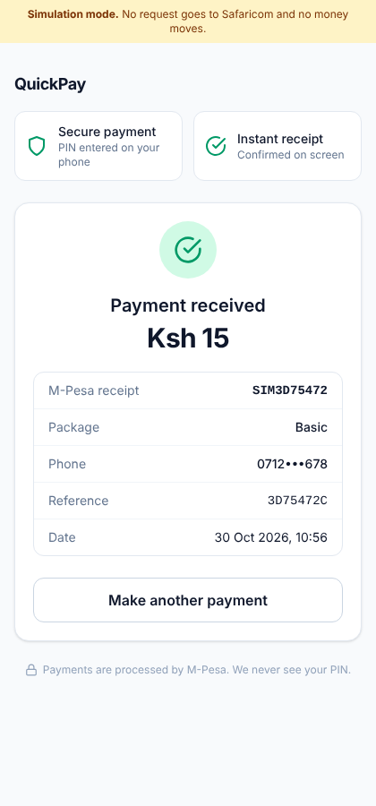
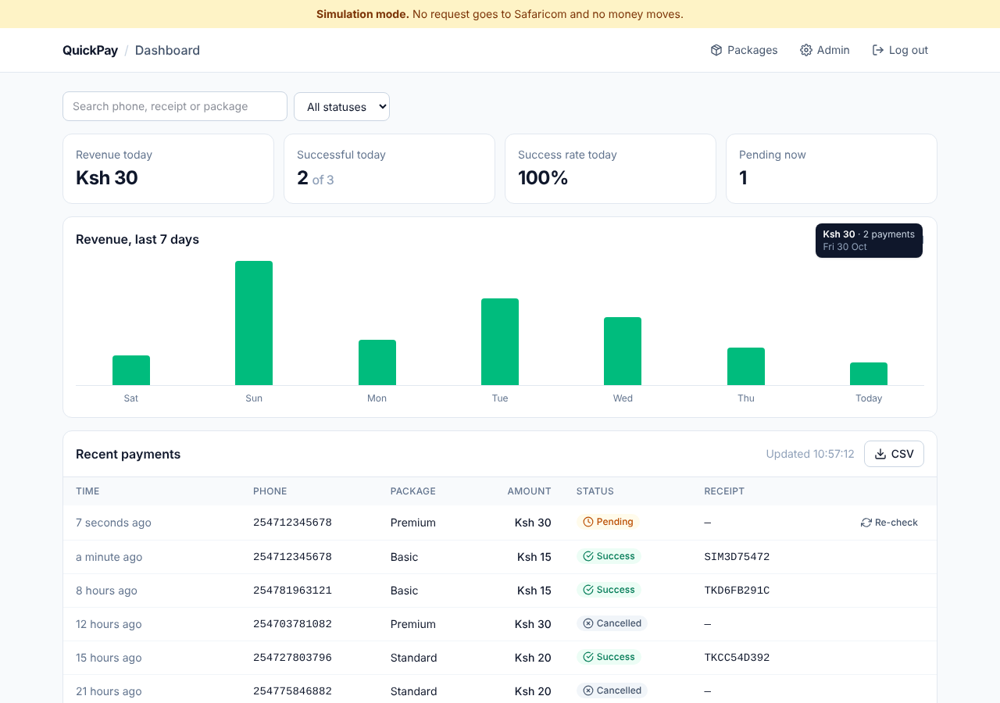

# M-Pesa Pay

A minimal, production-minded payment page for **M-Pesa Express (STK Push)** using Safaricom's Daraja API.
The customer enters their number, picks a package, gets a PIN prompt on their phone, and the page
updates itself when M-Pesa confirms. Staff get a live dashboard and the Django admin.

Built with Django 5.2 LTS, HTMX and Tailwind. Runs the same on macOS (Apple Silicon or Intel),
Windows and Linux.

| Payment page | Waiting for PIN | Paid |
|---|---|---|
|  |  |  |



## Features

- **STK Push checkout:** prices always come from the database, never from the browser.
- **Reliable status:** the Safaricom callback is the main signal. The STK Query endpoint is the
  fallback when a callback never arrives, and payments with no answer time out after 3 minutes.
- **Safe callbacks:** a secret callback URL, idempotent and row-locked processing, an amount check,
  and duplicate callbacks ignored.
- **Live updates:** the payment page polls every 3 s and the dashboard every 5 s (HTMX, no WebSockets
  needed).
- **Dashboard:** revenue today, success rate, a 7-day revenue chart, a searchable payments table,
  CSV export and a manual "Re-check" for stuck payments.
- **Django admin:** edit packages; payments are read-only financial records.
- **Abuse protection:** rate limits per phone number and per IP, and admin login lockout
  (django-axes).
- **Simulate mode:** run and demo everything with **no Safaricom account at all**.
- **Tests:** 44 tests covering the Daraja client, callbacks, timeouts and views, run in CI on
  Ubuntu, Windows and macOS.

## Quick start

Pick **one** of the three ways below. All of them start in *simulate mode*, so you can click through
a full payment without any API keys.

### Option 1: Docker (recommended, nothing else to install)

Install [Docker Desktop](https://www.docker.com/products/docker-desktop/), then:

```bash
git clone <your-repo-url> mpesa-pay && cd mpesa-pay
cp .env.example .env            # Windows (cmd): copy .env.example .env
docker compose up --build
```

This runs Django and PostgreSQL and creates an admin account from `ADMIN_USERNAME` /
`ADMIN_PASSWORD` in `.env`.

### Option 2: uv (fast, no Docker)

Install [uv](https://docs.astral.sh/uv/getting-started/installation/), then:

```bash
cp .env.example .env            # Windows (cmd): copy .env.example .env
uv sync                         # installs Python 3.12 and every dependency
uv run python manage.py migrate
uv run python manage.py createsuperuser
uv run python manage.py runserver
```

### Option 3: plain pip

Needs Python 3.12 or newer.

```bash
python -m venv .venv
source .venv/bin/activate       # Windows: .venv\Scripts\activate
pip install -r requirements.txt
cp .env.example .env            # Windows (cmd): copy .env.example .env
python manage.py migrate
python manage.py createsuperuser
python manage.py runserver
```

Options 2 and 3 use SQLite, so no database server is needed.

### Then open

| URL | What |
|---|---|
| http://localhost:8000 | Payment page. After paying, use the yellow *Simulation* buttons to act as the customer. |
| http://localhost:8000/dashboard/ | Live dashboard (staff login) |
| http://localhost:8000/admin/ | Django admin: packages and payment records |

## Using the real Daraja sandbox

1. Create an app on the [Daraja portal](https://developer.safaricom.co.ke) with *M-Pesa Express*
   enabled. Copy its **Consumer Key** and **Consumer Secret**.
2. Safaricom must be able to reach your callback URL, and it can't reach `localhost`. The easiest fix
   is a free [ngrok](https://ngrok.com) account:
   - claim your free static domain (e.g. `https://your-name.ngrok-free.app`);
   - copy your auth token.
3. Edit `.env`:

   ```ini
   MPESA_MODE=sandbox
   MPESA_CONSUMER_KEY=...
   MPESA_CONSUMER_SECRET=...
   MPESA_CALLBACK_BASE_URL=https://your-name.ngrok-free.app
   MPESA_CALLBACK_SECRET=<python -c "import secrets; print(secrets.token_urlsafe(32))">
   NGROK_AUTHTOKEN=...
   ```

   The sandbox shortcode `174379` and its passkey are already filled in.
4. Start the app together with the tunnel:

   ```bash
   docker compose --profile tunnel up --build
   ```

   Without Docker, run `ngrok http --url=https://your-name.ngrok-free.app 8000` in a second terminal.
5. Pay with your own Safaricom number. Every callback Safaricom sends appears at
   http://localhost:4040 (the ngrok inspector).

The app refuses to start if a required sandbox or production setting is missing, so
misconfiguration shows up immediately rather than mid-payment.

## Going live

Real payments need a Safaricom **paybill or till number** (a personal M-Pesa number can't receive
STK payments) and an approved **Go Live** request on the Daraja portal. Then:

```ini
DEBUG=0
SECRET_KEY=<long random string>
ALLOWED_HOSTS=pay.yourdomain.com
MPESA_MODE=production
MPESA_CONSUMER_KEY=...           # production app keys
MPESA_CONSUMER_SECRET=...
MPESA_PASSKEY=...                # sent by Safaricom after go-live
MPESA_SHORTCODE=...              # paybill, or store number for a till
MPESA_TRANSACTION_TYPE=CustomerPayBillOnline   # or CustomerBuyGoodsOnline for a till
MPESA_PARTY_B=                   # till number (tills only)
MPESA_CALLBACK_BASE_URL=https://pay.yourdomain.com
MPESA_CALLBACK_SECRET=<long random string>
```

Test with a KES 1 payment to your own phone, including cancelling the prompt.

## Deploying

The `Dockerfile` is production-ready: it runs gunicorn, serves static files via WhiteNoise and runs
migrations on start. It works on Render, Railway, Fly.io or any VPS with Docker.

- Add a PostgreSQL database and set `DATABASE_URL`.
- Set the variables from *Going live*, plus `USE_X_FORWARDED_FOR=1` (these platforms sit behind a
  proxy).
- Schedule `python manage.py reconcile_pending` every minute or so. This catches payments whose
  callback never arrived and whose customer closed the page. An open dashboard also does this
  automatically.

## How a payment flows

```
Browser ──POST /pay/──▶ Django ──STK push──▶ Daraja ──PIN prompt──▶ Customer's phone
   ▲                      │  saves PENDING                                │
   │ polls /status/       │                                               │ enters PIN
   │ every 3 s            ◀──────── POST /callbacks/mpesa/<secret>/ ◀─────┘
   │                      │  SUCCESS / FAILED / CANCELLED (row-locked, idempotent)
   └──── receipt ◀────────┘
          (no callback after 20 s? → STK Query; no answer after 3 min → TIMEOUT)
```

## Project layout

```
config/            settings (all values from environment variables), URLs
payments/
  daraja.py        HTTP client for Daraja: OAuth, STK push, STK query, phone normalising
  services.py      business logic: start payment, process callback, status fallback
  models.py        Package, Transaction (the database is the source of truth)
  views.py         payment page, status polling, callback endpoint, simulate mode
  admin.py         Django admin config (read-only payments, CSV export, re-check)
  management/      reconcile_pending, ensure_admin
  tests/           44 tests, no network needed
dashboard/         staff dashboard views
templates/         Django templates (HTMX partials start with _)
static/            compiled CSS (committed) and vendored htmx, so it works offline
assets/            Tailwind source
docker/            container entrypoint
```

## Development

```bash
uv run python manage.py test       # run the tests
uv run ruff check . && uv run ruff format .

# Only after changing CSS classes in templates (downloads Tailwind's standalone binary, no Node needed):
uv run tailwindcss -i assets/tailwind.css -o static/css/app.css --minify
```

Every push runs CI with tests on Ubuntu, Windows and macOS, linting, a Docker Compose smoke test,
and a production image build for both amd64 and arm64.

## Security notes

- Never commit `.env`; `.gitignore` already excludes it.
- Simulate mode only runs with `DEBUG=1`, because it lets anyone mark payments as paid.
- Callbacks aren't signed by Safaricom. Protection comes from the secret URL, matching
  `CheckoutRequestID`s that only the server ever sees, and checking the amount paid.
- Change the default `ADMIN_PASSWORD` before deploying anywhere public.

Icons from [Feather](https://feathericons.com) (MIT).
